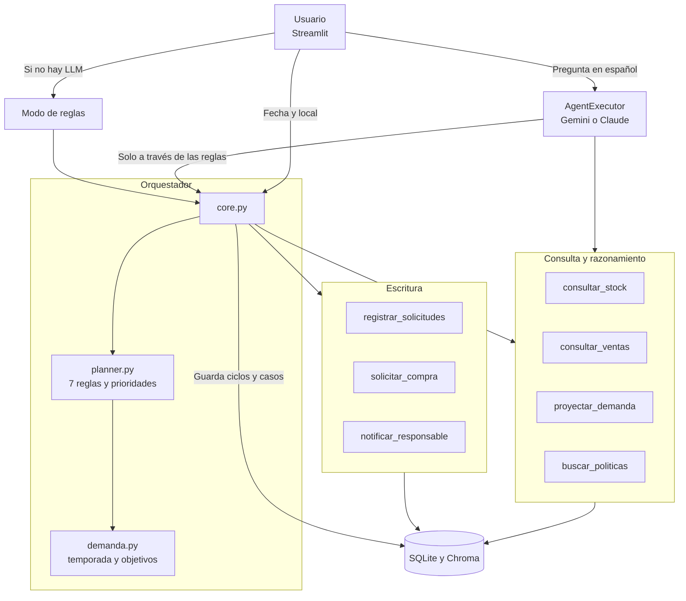

# Agente de reposición de stock

Agente de IA que decide qué reponer, qué devolver y qué comprar para las tiendas y el canal online de una
perfumería, de cara a la temporada alta de noviembre y diciembre.

**EP2 · ISY0101 Ingeniería de Soluciones con IA**
Leonardo Luis Amundarain Cabrera y Francisco Miguel Espinoza Moyano

> Incluye **datos reales** de ventas y stock de la empresa, publicados con su autorización, en `data/reales/`.
> También trae datos simulados en `data/muestra/`, que usan las pruebas automáticas.

## El problema

Cada local se abastece desde una bodega central y vende miles de productos. Hacerlo a mano implica cruzar
ventas con stock producto por producto. Este proyecto continúa la EP1, donde un agente solo consultaba
información ya calculada: ahora también razona con reglas, planifica y registra acciones.

| Local | Línea | Caja | Bodega | Reposición |
|---|---|---|---|---|
| 14 | Tienda diseñador (solo línea `DISEÑADOR`) | 14 | B14 | Hasta 2 veces por semana; demora 2 días |
| 15 | Tienda árabes (solo línea `ARABES / DUPES`) | 15 | B15 | Hasta 2 veces por semana; demora 2 días |
| 16 | Online | 37 | B16 | 2 veces al mes |

Detalle en [docs/alcance.md](docs/alcance.md) y [docs/reglas.md](docs/reglas.md).

## Arquitectura



Más diagramas en [docs/diagrama_orquestacion.md](docs/diagrama_orquestacion.md).

### Componentes

| Componente | Archivo | Función |
|---|---|---|
| Limpieza y cruce | `agent/datos.py` | Excluye lo que no es venta y cruza por código o EAN |
| Proyección | `agent/demanda.py` | Temporada alta y objetivos de stock |
| Planner | `agent/planner.py` | Reglas, prioridades y replanificación |
| Orquestador | `agent/core.py` | Ejecuta el plan, retoma tareas y conversa |
| Tools | `agent/tools/` | 7 herramientas ([contratos](docs/tools.md)) |
| Memoria | `agent/memory/` | Corto plazo, largo plazo y semántica |
| Interfaz | `app.py` | Planificar, conversar, solicitudes y pedidos |

### Memoria

| Tipo | Dónde | Para qué |
|---|---|---|
| Corto plazo | `ConversationBufferMemory` | Recordar el local mencionado en la conversación |
| Largo plazo | SQLite: `ciclos`, `solicitudes` | Saber qué viene en camino, cumplir la frecuencia y retomar tareas tras reiniciar |
| Semántica | Chroma: `politicas`, `casos_previos` | Encontrar políticas por significado y recordar ciclos anteriores |

### Planificación

El agente sigue un plan de 12 pasos, definido en `agent/planner.py` (`PLAN_BASE`) y ejecutado por el orquestador en
`agent/core.py`:

| # | Paso | Qué hace |
|---|---|---|
| 1 | `recordar_ciclo_anterior` | Lee el último ciclo del local y revisa si ya corresponde un pedido nuevo según la frecuencia |
| 2 | `consultar_stock` | Stock del local y de la bodega central |
| 3 | `consultar_ventas` | Venta diaria del local, sin las ventas mayoristas |
| 4 | `proyectar_demanda` | Venta esperada, con factor 1,5 en temporada alta |
| 5 | `decidir_por_producto` | Aplica las 7 reglas a cada producto, descontando lo que ya viene en camino |
| 6 | `secuenciar_por_prioridad` | Ordena por urgencia y reparte primero la central a lo más urgente |
| 7 | `buscar_politicas` | Recupera por significado la política que respalda cada acción |
| 8 | `registrar_devoluciones` | Registra lo que vuelve a la bodega central |
| 9 | `registrar_reposiciones` | Registra lo que sale de la central hacia el local |
| 10 | `solicitar_compra` | Registra lo que la central no puede cubrir |
| 11 | `notificar_responsable` | Avisa al local o a compras con el resumen del ciclo |
| 12 | `guardar_memoria` | Guarda el ciclo en SQLite y como caso en la memoria semántica |

En la interfaz, cada paso ejecutado se ve en **Plan y razonamiento del agente**. El plan se adapta según lo que
encuentra:

- Cada tienda repone solo su línea; lo de otra línea se vende hasta agotarse, porque la venta está migrando de a poco.
- Ordena los productos por urgencia y reparte primero la central a lo más urgente.
- Quita del plan los pasos sin trabajo (por ejemplo, el 8 si no hay nada que devolver).
- Si la central cambia durante el paso 9, ajusta las cantidades y agrega el paso 10 si no estaba.
- Las decisiones cambian con la fecha: en temporada alta sube el objetivo de stock.
- Al recibir una compra, retoma los productos que la esperaban.

## Inicio rápido

En Windows, haz doble clic en **`iniciar.bat`**. En Mac o Linux, ejecuta `./iniciar.sh`. El iniciador:

1. Crea el entorno de Python e instala las dependencias (solo la primera vez).
2. Pide las API keys de Gemini y Claude, las valida y las guarda en `.env`. Puedes omitirlas.
3. Carga los datos y prepara la memoria semántica.
4. Abre el agente en el navegador.

Para cambiar las API keys más tarde, ejecuta `iniciar.bat --claves`. Requiere Python 3.10 o superior.

## Instalación manual


Requiere Python 3.10 o superior.

**En Windows, clona en una ruta corta y fuera de OneDrive**, por ejemplo `C:\dev`. Algunos archivos de `torch` agregan
unos 150 caracteres a la ruta del proyecto y Windows limita las rutas a 260. Si la ruta es larga, `pip` falla con
`OSError: [Errno 2] No such file or directory`. Además, `.venv` tiene miles de archivos que OneDrive intentaría sincronizar.

```bash
git clone https://github.com/TU_USUARIO/reposicion-stock-agent-lamundarain_fespinoza.git
```

```bash
cd reposicion-stock-agent-lamundarain_fespinoza
```

```bash
python -m venv .venv
```

Activa el entorno. En PowerShell:

```powershell
.venv\Scripts\Activate.ps1
```

En Mac o Linux:

```bash
source .venv/bin/activate
```

Instala las dependencias (puede tardar varios minutos):

```bash
pip install -r requirements.txt
```

`requirements.lock.txt` tiene las versiones exactas con que se probó.

### Configurar el LLM (opcional)

El agente puede conversar con **Gemini** o **Claude**; el panel permite elegir cualquiera de los dos. Sin API key,
funciona con el modo de reglas. Copia `.env.example` como `.env` y agrega la key del proveedor que vayas a usar:

| Proveedor | Variable | Dónde obtenerla | Costo |
|---|---|---|---|
| Gemini (por defecto) | `GOOGLE_API_KEY` | [AI Studio](https://aistudio.google.com/apikey) | Nivel gratuito |
| Claude | `ANTHROPIC_API_KEY` | [Consola de Anthropic](https://console.anthropic.com/) | Pago por uso |

Cada persona usa su propia key. Las keys van solo en `.env`: nunca en `.env.example`, que sí se publica.
Para Gemini, verifica la conexión con:

```bash
python scripts/verify_llm.py
```

En el panel eliges el proveedor y el modelo:

| Proveedor | Modelos | Si el modelo falla |
|---|---|---|
| Gemini | 3.6 Flash, 3.5 Flash-Lite, 3 Flash Preview, 3.7 Flash, 3.5 Flash, 3.8 Flash y 3.1 Flash-Lite | Prueba el siguiente de la lista, porque es gratis |
| Claude | Haiku 5.5, Sonnet 5.5, Opus 5.5 y Fable 5.1 | Pasa al modo de reglas, porque es de pago |

El agente nunca envía los datos al otro proveedor sin que lo elijas. Las listas están en `config/settings.py`.

## Ejecución

Carga los datos. El índice semántico descarga el modelo de embeddings la primera vez:

```bash
python -m scripts.seed_data
```

```bash
python -m scripts.index_politicas
```

Abre la interfaz en `http://localhost:8501`:

```bash
streamlit run app.py
```

**Reiniciar demo** borra las solicitudes de prueba y restaura el stock inicial, sin volver a leer los archivos. Si cambias
los archivos de ventas o stock, ejecuta de nuevo `python -m scripts.seed_data`, con esos archivos cerrados en Excel.

### Ejemplos

| Pestaña | Prueba | Resultado |
|---|---|---|
| Planificar | Local 15, 2026-11-03 | Repone `QUIEBRE15`, devuelve `LENTO15` y compra `AGOTADO15` |
| Planificar | Local 15, 2026-11-20 (tras reiniciar) | `QUIEBRE15` sube de 9 a 14 por temporada alta |
| Planificar | Local 14, simular `MERMA14:8` | Repone 4 y replanifica la compra |
| Conversar | «planifica la tienda de árabes» | Ejecuta el ciclo del local 15 |
| Conversar | «cómo libero espacio en el local» | Cita la política de devoluciones |
| Pedido de tienda | Local 15, `QUIEBRE15`, 50 unidades | Aprueba solo 9 |

Escenarios paso a paso en [docs/guion_demo.md](docs/guion_demo.md).

## Pruebas y evidencia

```bash
pytest tests/ -v
```

| Evidencia | Contenido |
|---|---|
| `evidence/pytest_output.txt` | Resultado de las pruebas |
| `evidence/escenarios.json` | 11 escenarios de decisión (`python -m scripts.demo_escenarios`) |
| `evidence/eval_embeddings.md` | Comparación de modelos de embeddings (`python -m scripts.eval_embeddings`) |
| `evidence/conversacion_gemini.json` | Conversación real con Gemini sobre datos simulados (`python -m scripts.evidencia_llm gemini`) |
| `evidence/conversacion_claude.json` | Conversación real con Claude sobre datos simulados (`python -m scripts.evidencia_llm claude`) |
| `evidence/screenshots/` | Capturas de la interfaz |

Las pruebas automáticas de la conversación usan un LLM falso, para no depender de internet: verifican la conexión
entre componentes. El comportamiento con los modelos reales queda en `evidence/conversacion_gemini.json` y
`evidence/conversacion_claude.json`.

## Datos

| Carpeta | Contenido | Uso |
|---|---|---|
| `data/reales/` | Ventas de junio a octubre de 2026 y stock, de la empresa | Opción por defecto (`FUENTE_DATOS=real`) |
| `data/muestra/` | Datos simulados con las mismas columnas | Pruebas automáticas y evidencia; se activan con `FUENTE_DATOS=simulado` |

Para usar otros archivos, cambia `RUTA_VENTAS` y `RUTA_STOCK` en el `.env` y ejecuta `python -m scripts.seed_data`.

Para generar el Excel de sugeridos, indica una ruta fuera del proyecto:

```bash
python -m scripts.exportar_resultados C:/ruta/sugeridos.xlsx 2026-11-03
```

Con `FUENTE_DATOS=real`, el LLM queda apagado por defecto, con ambos proveedores. Para activarlo, agrega
`PERMITIR_LLM_CON_DATOS_REALES=true` al `.env`, con autorización de la empresa. Las tools no le entregan costos ni montos,
pero sí nombres de productos, stock y ventas en unidades. En el nivel gratuito de Gemini, Google usa ese contenido para
mejorar sus productos; revisa los términos del proveedor que elijas.

## Limitaciones

- No hay historial de quiebres: una venta en cero por falta de stock parece falta de demanda.
- El factor de temporada y sus fechas son una estimación del negocio.
- La demanda de un producto que migra de tienda no se suma aún al objetivo de la tienda que lo recibirá.
- La lista de compra puede incluir productos descontinuados; una persona debe revisarla.
- La búsqueda semántica no siempre acierta, por lo que las reglas no dependen de ella.
- El agente no descuenta lo vendido entre un pedido y el siguiente: hay que cargar un archivo de stock actualizado.
- En el nivel gratuito, los modelos de Gemini pueden saturarse. Las respuestas del LLM pueden variar en su redacción.

Decisiones de diseño: [docs/decisiones_diseno.md](docs/decisiones_diseno.md).

## Relación con la pauta

| Indicador | Evidencia |
|---|---|
| IE1 Herramientas | `agent/tools/`, `tests/test_tools.py` |
| IE2 Frameworks | LangChain, Chroma, Streamlit; `requirements.txt` |
| IE3 Memoria | `agent/memory/short_term.py`, `long_term.py`, `tests/test_e2e.py` |
| IE4 Recuperación semántica | `agent/memory/semantic.py`, `evidence/eval_embeddings.md` |
| IE5 Planificación | `agent/planner.py`, `tests/test_planner.py` |
| IE6 Documentación | Este README, `docs/` e informe |
| IE7 Decisiones adaptativas | `evidence/escenarios.json`, `docs/guion_demo.md` |
| IE8 Arquitectura | `docs/diagrama_orquestacion.md`, este README |
| IE9 Justificación | `docs/decisiones_diseno.md` |
| IE10 Comunicación técnica | Presentación y evidencias |

## Declaración de uso de IA

| Herramienta | Uso | Validado por |
|---|---|---|
| Gemini | Motor de conversación del agente (opción por defecto) | Leonardo Amundarain y Francisco Espinoza |
| Claude (API de Anthropic) | Motor de conversación del agente (opción seleccionable) | Leonardo Amundarain |
| Claude Code (Anthropic, Claude Opus, Hikun, Fable, Sonet) | Generación de parte del código, datos simulados, diagrama mermaid | Leonardo Amundarain y Francisco Espinoza |

## Informe y justificación

- Informe técnico: [docs/Informe_EP2_Amundarain_Espinoza.pdf](docs/Informe_EP2_Amundarain_Espinoza.pdf)
- Justificación de las decisiones de diseño: [docs/decisiones_diseno.md](docs/decisiones_diseno.md#justificación-del-equipo)

